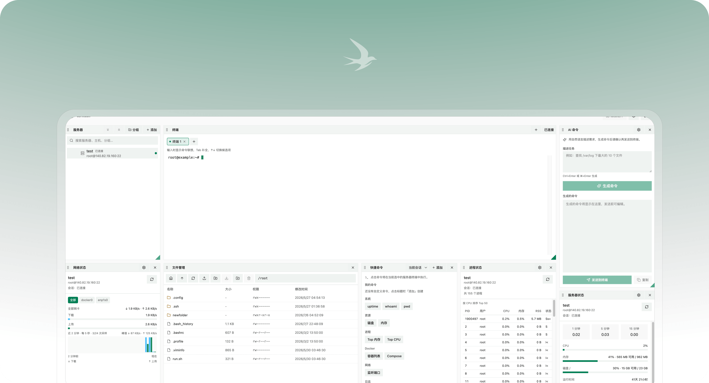

<p align="center">
  <picture>
    <source media="(prefers-color-scheme: dark)" srcset="web/public/logo-dark.png" />
    <source media="(prefers-color-scheme: light)" srcset="web/public/logo-light.png" />
    
  </picture>
</p>

<h1 align="center">ternssh-mcp</h1>

<p align="center">Self-hosted SSH workspace with Model Context Protocol (MCP) access</p>

<p align="center">
  <a href="LICENSE">GPL-3.0-or-later</a> · <a href="README.zh.md">中文</a>
</p>

**ternssh-mcp** is based on the Cloudflare SSH workspace [ternssh](https://github.com/haradakashiwa/ternssh). This modified distribution is dated **2026-11-26** and adds the MCP features below.

## MCP features

- **Client pairing and server grants.** Issue revocable tokens per client and select which SSH servers those clients can access. Changing a server's SSH address, port, or login invalidates its grant.
- **Diagnostics and managed file transfer.** Run fixed diagnostics with `run_diagnostic`, or prepare an upload or download and complete it with the local transfer CLI. See the [file transfer guide (Chinese)](docs/mcp-file-transfers.md).
- **Isolated Linux workspace jobs.** Opt in per server to run temporary jobs with `run_workspace_command`. See the [host requirements and limits (Chinese)](docs/mcp-workspace.md).
- **Touch ID command approval.** Review the exact SSH command batch in a locally built macOS app and approve it with Touch ID before execution. See the [command batch guide (Chinese)](docs/mcp-command-batches.md).
- **Resumable job output.** Read stdout and stderr while a job runs, fetch the tail of either stream, or resume from a saved cursor. See the [output and retention guide (Chinese)](docs/mcp-job-output.md).

## Deployment

### Docker

```sh
docker compose up -d --build
```

Open `http://localhost:8787` to create the initial account. Serve the instance over HTTPS for remote MCP clients and the transfer CLI.

### Cloudflare Workers

Use Node.js 22.12 or later. Create a D1 database named `ternssh` in your Cloudflare account and authenticate Wrangler.

```sh
npm ci --ignore-scripts
npm ci --prefix server
npm ci --prefix web
CLOUDFLARE_ACCOUNT_ID=your-account-id D1_DATABASE_ID=your-d1-id npm run release
```

The release command builds the frontend, applies the D1 migrations and deploys the Worker. For Cloudflare Access authentication, set the runtime variables `ACCESS_TEAM_DOMAIN` and `ACCESS_AUD` in your Worker settings.

## Connect an MCP client

1. Add **MCP Access** from the dashboard component menu. Select the servers and confirm the selection. Each confirmation replaces the full selection for the workspace.
2. Open the web terminal for each selected server and verify the SSH host key. Independent MCP sessions check the recorded key before using the saved credentials.
3. In the card settings, copy the MCP endpoint and create a dedicated token. Store the token in the client's secure environment as `TERNSSH_MCP_TOKEN`.
4. Configure the client with the HTTPS `/mcp` endpoint and bearer token. For example, in Codex, replace the example URL with the address shown on the card.

```sh
codex mcp add ternssh --url https://your-ternssh.example/mcp --bearer-token-env-var TERNSSH_MCP_TOKEN
```

Use `list_authorized_servers` to obtain server IDs. To revoke access, end the workspace authorization or revoke an individual client token in the card settings.

<picture>
  <source media="(prefers-color-scheme: dark)" srcset="docs/preview-dark.png" />
  <source media="(prefers-color-scheme: light)" srcset="docs/preview-light.png" />
  
</picture>

## Upstream desktop client

[**ternssh desktop**](https://github.com/haradakashiwa/ternssh-desktop) is a native client for macOS and Windows: an SSH terminal and server manager with a native UI, no WebView.

- **Works on its own**: manage servers and local terminals on your machine without any site, with credentials in the system keychain.
- **Syncs with your ternssh sites**: add a site and its servers, groups and snippets appear in a tab of their own; changes made in the client are written back to the site. Sites behind Cloudflare Access open a sign-in window when asked, or take a service token.
- **Connects from your machine**: a site only syncs the SSH details, and no traffic goes through it.
- Terminal tabs, SFTP with an editor, snippets, live server status, a tray and a global hotkey.

<p align="center">
  
</p>

### Download

Get the latest from [Releases](https://github.com/haradakashiwa/ternssh-desktop/releases/latest):

| System | File |
|---|---|
| macOS (Apple silicon and Intel) | `ternssh-<version>-macos-universal.dmg` |
| Windows x64 | `…-windows-amd64-setup.exe` (installer) or `…-windows-amd64-portable.zip` |
| Windows ARM64 | `…-windows-arm64-setup.exe` or `…-windows-arm64-portable.zip` |

The builds are not signed with a developer certificate: on macOS, right-click the app and choose "Open" the first time; on Windows, if SmartScreen warns, click "More info" → "Run anyway". Syncing a site needs a recent ternssh, which gives the client the servers' credentials.
