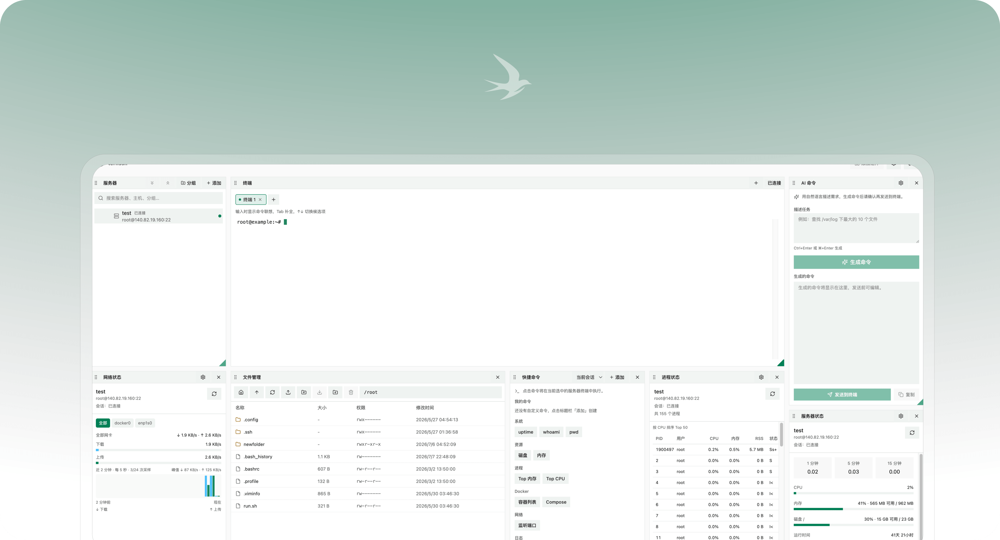

<p align="center">
  <picture>
    <source media="(prefers-color-scheme: dark)" srcset="web/public/logo-dark.png" />
    <source media="(prefers-color-scheme: light)" srcset="web/public/logo-light.png" />
    
  </picture>
</p>

<h1 align="center">ternssh-mcp</h1>

<p align="center">支持模型上下文协议（MCP）的自托管 SSH 工作台</p>

<p align="center">
  <a href="LICENSE">GPL-3.0-or-later</a> · <a href="README.md">English</a>
</p>

**ternssh-mcp** 基于 Cloudflare SSH 工作台 [ternssh](https://github.com/haradakashiwa/ternssh)。此修改版日期为 **2026-11-26**，新增以下 MCP 功能。

## MCP 功能

- **客户端配对与主机授权。** 为各客户端签发可撤销的专用令牌，并选择允许访问的 SSH 主机。主机的 SSH 地址、端口或登录账号变更后，原授权失效。
- **固定诊断与受管文件传输。** 通过 `run_diagnostic` 运行诊断，或在 MCP 中准备上传、下载，再用本机命令完成传输。见[文件传输指南](docs/mcp-file-transfers.md)。
- **隔离的 Linux 工作目录任务。** 按主机开启权限，通过 `run_workspace_command` 在临时目录运行任务。见[主机要求与限额](docs/mcp-workspace.md)。
- **Touch ID 命令审批。** 用本机构建的 macOS 应用查看完整 SSH 命令批次，完成 Touch ID 审批后再执行。见[命令批次指南](docs/mcp-command-batches.md)。
- **任务输出续读。** 运行时读取标准输出和标准错误，可单独定位任一输出流的末尾，也可在重连后按游标续读。见[任务输出与保留期限](docs/mcp-job-output.md)。

## 部署

### Docker

```sh
docker compose up -d --build
```

访问 `http://localhost:8787` 创建初始账号。远程 MCP 客户端和本机传输工具需要通过 HTTPS 访问实例。

### Cloudflare Workers

使用 Node.js 22.12 或更高版本。在自己的 Cloudflare 账户创建名为 `ternssh` 的 D1 数据库，并完成 Wrangler 登录。

```sh
npm ci --ignore-scripts
npm ci --prefix server
npm ci --prefix web
CLOUDFLARE_ACCOUNT_ID=your-account-id D1_DATABASE_ID=your-d1-id npm run release
```

发布命令会构建前端、应用 D1 迁移并部署 Worker。如需使用 Cloudflare Access 认证，请在 Worker 设置中配置运行时变量 `ACCESS_TEAM_DOMAIN` 和 `ACCESS_AUD`。

## 接入 MCP 客户端

1. 从工作台的「添加组件」菜单加入「MCP 接入」卡片，选择允许访问的主机并确认授权。每次确认都会替换工作区的整份授权名单。
2. 在网页终端连接已选主机并核验 SSH 主机密钥。独立的 MCP 会话会在使用已保存凭据前核对已记录的密钥。
3. 在卡片设置中复制 MCP 接入地址并创建专用令牌，将令牌存入客户端的安全环境变量 `TERNSSH_MCP_TOKEN`。
4. 在客户端配置 HTTPS `/mcp` 地址和 Bearer 令牌。使用 Codex 时，将下面的示例地址替换成卡片里显示的地址。

```sh
codex mcp add ternssh --url https://your-ternssh.example/mcp --bearer-token-env-var TERNSSH_MCP_TOKEN
```

调用 `list_authorized_servers` 可获取主机标识。需要收回访问权限时，在卡片里结束工作区授权或撤销单一客户端的令牌。

<picture>
  <source media="(prefers-color-scheme: dark)" srcset="docs/preview-dark.png" />
  <source media="(prefers-color-scheme: light)" srcset="docs/preview-light.png" />
  
</picture>

## 上游桌面客户端

[**ternssh desktop**](https://github.com/haradakashiwa/ternssh-desktop) 是 ternssh 的原生桌面客户端，支持 macOS 和 Windows：SSH 终端与服务器管理工具，界面为原生 UI，没有 WebView。

- **本机即可使用**：不添加站点也能管理服务器和本地终端，凭据存在系统钥匙串。
- **与站点同步**：添加 ternssh 站点后，站点上的服务器、分组和快捷指令出现在独立的标签里，在客户端的修改会写回站点。站点受 Cloudflare Access 保护时，会弹出登录窗口，也可以使用服务令牌。
- **所有连接都从本机发起**：站点只用来同步 SSH 信息，不经它转发流量。
- 多标签终端、SFTP 与文件编辑器、快捷指令、服务器状态实时监控、托盘与全局快捷键。

<p align="center">
  
</p>

### 下载

在 [Releases](https://github.com/haradakashiwa/ternssh-desktop/releases/latest) 下载最新版本：

| 系统 | 文件 |
|---|---|
| macOS（Apple 芯片与 Intel） | `ternssh-<版本>-macos-universal.dmg` |
| Windows x64 | `…-windows-amd64-setup.exe`（安装包）或 `…-windows-amd64-portable.zip`（免安装） |
| Windows ARM64 | `…-windows-arm64-setup.exe` 或 `…-windows-arm64-portable.zip` |

安装包没有开发者证书签名：macOS 首次打开时请右键应用选「打开」；Windows 若出现 SmartScreen 提示，点「更多信息」→「仍要运行」。同步站点需要较新版本的 ternssh（客户端需要从站点获取服务器凭据）。
